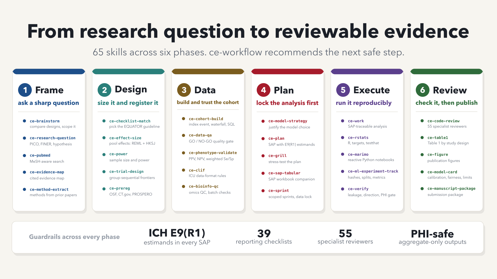
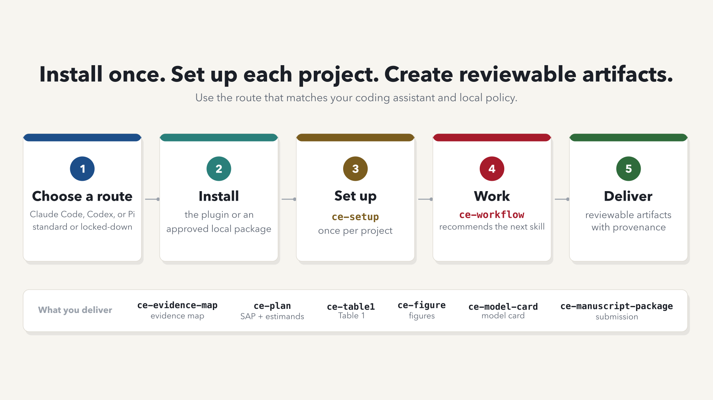

# Compound Health Data Science

**A practical AI research partner for health and biomedical data.**

Methodsmith helps you move from an idea to a careful, documented analysis. You
can ask your coding assistant to help plan a study, find relevant evidence,
check a dataset, write analysis code, review the results, and prepare a report.

You stay in control of the scientific decisions. The plugin does not replace a
researcher, statistician, clinician, data steward, or ethics review.

[Read the public documentation](https://sajor2000.github.io/methodsmith/) · [Watch the workflow overview](https://sajor2000.github.io/methodsmith/media/methodsmith-overview.mp4)

**65 skills, 55 specialist agents, and 39 reporting checklists** help make each project more explicit, reproducible, and reviewable.

## In plain English

If you work with health data, this plugin gives your AI assistant a set of
specialized workflows for the work around the code — the questions, decisions,
checks, documentation, and reviews that make an analysis more trustworthy.

It can help you:

- turn a broad research idea into a clear question and study plan;
- search and organize published evidence;
- build a study group from R or Python data;
- check whether data, joins, missing values, and variables make sense;
- keep important statistical choices visible before analysis;
- review a manuscript or report against common research checklists; and
- leave behind reusable notes and artifacts so the next analysis is easier.

## Who is it for?

Researchers, analysts, students, clinicians, and data teams who use R or
Python for health, biomedical, clinical, claims, EHR, omics, or related data.
You do not need to memorize the right command: describe what you are trying to
do, and the workflow helps identify the next step.

## Try it in three steps

1. Install it for the AI coding tool you already use.
2. Open the project or study folder where you want to work.
3. Ask the assistant to set up Methodsmith, then describe your research goal.

For example:

```text
Use Methodsmith to set up this project, then help me plan a study of
30-day mortality among ICU patients with sepsis. Show me the decisions I need
to make before we analyze any data.
```

The quickest install paths are below. If you are not sure which one applies,
start with Claude Code or Codex and follow the matching section.



## How the package works



---

## Get started like Compound Engineering

The normal path is intentionally short: install the plugin, start your agent,
then run setup. For complete platform details, see the
[public setup guide](https://sajor2000.github.io/methodsmith/docs/setup).

### Choose your install route

From a source checkout, run `bash install.sh doctor` to see which local tools
are available and the exact standard or locked-down route. Use the standard
route on a personal or managed laptop that can run Git and the agent CLI. On a
corporate or locked-down laptop, ask IT for the approved offline artifact and
use the artifact-specific path below; Bun, Git, GitHub CLI, and Quarto are not
required for basic use.

### Claude Code, easiest path

No checkout needed (Claude Code 2.1.275 or later):

```bash
claude plugin install methodsmith --marketplace sajor2000/methodsmith
claude
```

Or, inside a running Claude Code session:

```text
/plugin install methodsmith --marketplace sajor2000/methodsmith
```

From a source checkout, with the optional bare `/method-*` aliases, on macOS,
Linux, WSL, or Git Bash:

```bash
git clone https://github.com/sajor2000/methodsmith.git ~/methodsmith
cd ~/methodsmith
bash install.sh claude --aliases
claude
```

Windows PowerShell:

```powershell
git clone https://github.com/sajor2000/methodsmith.git "$HOME\methodsmith"
cd "$HOME\methodsmith"
.\install.ps1 claude -Aliases
claude
```

Then open the target project and run the native command:

```text
/methodsmith:method-setup
```

The `--aliases` flag is optional; it installs safe local aliases so the
demo-friendly bare `/method-*` commands work. The namespaced command above is the
reliable default for every native Claude plugin install.

### Codex, easiest path

macOS, Linux, WSL, or Git Bash:

```bash
git clone https://github.com/sajor2000/methodsmith.git ~/methodsmith
cd ~/methodsmith
bash install.sh codex
codex
```

Windows PowerShell:

```powershell
git clone https://github.com/sajor2000/methodsmith.git "$HOME\methodsmith"
cd "$HOME\methodsmith"
.\install.ps1 codex
codex
```

Inside Codex, open `/plugins`, install **Methodsmith**, restart Codex, then
start a new thread and ask Codex to use Methodsmith for setup. The helper
also installs the generated agent bridge when Bun is available.

### Pi, generated install

Install Pi's two workflow extensions once, then generate the CE files into the
Pi agent root:

```bash
pi install npm:pi-subagents
pi install npm:pi-ask-user
cd ~/methodsmith
bun run src/index.ts install ./plugins/methodsmith --to pi --pi-home "$HOME/.pi/agent"
```

Restart Pi, open the project, then invoke `method-setup` with Pi's normal skill
interface. `pi-subagents` is required for CE review/workflow delegation;
`pi-ask-user` enables the short setup confirmation UI.

### Use the plugin after installation

Installation makes Methodsmith available to the agent; setup configures it
for each individual code or research project. After installing:

1. Restart Claude Code, Codex, or Pi so it loads the new plugin files.
2. Open the project or study directory you want Methodsmith to work on.
3. Configure that project with the setup skill.
4. Run the workflow skill to see the ordered research or engineering lifecycle
   and the next recommended skill.

In Claude Code, native plugin commands are namespaced:

```text
/methodsmith:method-setup
/methodsmith:method-workflow
```

When `--aliases` or `-Aliases` was used, the shorter `/method-setup` and
`/method-workflow` forms work too. In Codex, start a new task and say:

```text
Use the Methodsmith method-setup skill for this project.
Then use the Methodsmith method-workflow skill and recommend the next step.
```

After that, request a specific skill in plain language or use its displayed
name, for example `method-question`, `method-data-qa`, `method-plan`, or
`method-review`. The plugin works in the currently open project; repeat setup
when moving to a different project with a different stack or data layer.

Setup starts with one detected-profile summary instead of a full questionnaire.
It shows inferred language, environment, reporting format, storage, and data
domain with evidence, then offers **Continue**, **Adjust**, or **Full survey**.
It asks only for values that are ambiguous or needed by the current workflow.


### Locked-down or demo laptop

Use the offline release artifacts when package managers, GitHub CLI, Git, Bun,
or Quarto are blocked by IT policy. Basic Claude Code and Codex use does not
require Bun, GitHub CLI, or Quarto.

Claude Code can load the approved plugin folder or ZIP directly:

```bash
claude --plugin-dir /approved/path/methodsmith
claude --plugin-dir /approved/path/methodsmith.zip
```

Native Claude plugin skills are namespaced:

```text
/methodsmith:method-setup --locked-down
/methodsmith:method-workflow
```

Bare `/method-*` commands are an optional local alias layer, not a native plugin
guarantee. Install them only when you want demo-friendly command names:

```bash
bash scripts/install/install-claude-aliases.sh --plugin-dir /approved/path/methodsmith --scope user
```

For Codex without Bun, unpack `methodsmith-codex-local.zip` and run:

```bash
bash install-codex-offline.sh --source /approved/path/methodsmith-codex-local --codex-home "${CODEX_HOME:-$HOME/.codex}"
```

On Windows PowerShell, use the package's native installer:

```powershell
.\install.ps1 codex -Source C:\approved\methodsmith-codex-local -CodexHome "$HOME\.codex"
```

Restart Codex, open `/plugins`, install Methodsmith from the local
marketplace, then restart again. The installer writes the personal marketplace
file under `.agents/plugins/marketplace.json` and points it at
`./.codex/plugins/methodsmith` relative to that marketplace root.

### Recommended research add-ons

Methodsmith's bundled `/method-pubmed` workflow works on its own. For agent-native
PubMed, Europe PMC, MeSH, citation, and related-article tools, optionally add
[cyanheads/pubmed-mcp-server](https://github.com/cyanheads/pubmed-mcp-server).
For full-text synthesis, claim verification, figures, trials, regulatory
documents, preprints, and biological databases, optionally add the
[Paperclip CLI and its official Paperclip skill, or its MCP server](https://paperclip.gxl.ai/docs).

Start with PubMed MCP for lightweight biomedical discovery; add Paperclip when
research planning needs deeper full-text or cross-source evidence. Neither is
required or installed automatically. Review institutional privacy and network
policy before connecting a hosted research service. See the
[optional research add-ons setup](docs/setup.md#8-optional-research-add-ons).
The Paperclip skill is fetched and maintained by Paperclip, not bundled with CE
DataScience. CE workflows currently auto-detect the Paperclip CLI only; external
MCP or provider-skill results are direct agent capabilities, not automatic CE
artifact handoffs.

### Source checkout for contributors

Bun and Git are contributor/release tooling. Install them only when you need to
build, validate, or convert the plugin from source:

```bash
curl -fsSL https://bun.sh/install | bash
export CE_DS_REPO="$HOME/methodsmith"
git clone https://github.com/sajor2000/methodsmith.git "$CE_DS_REPO"
cd "$CE_DS_REPO"
bun install
```

Launch Claude Code from the checkout:

```bash
claude --plugin-dir "$CE_DS_REPO/plugins/methodsmith"
```

**Pro tip** — save yourself typing forever:

```bash
printf "\nalias claude-ds='claude --plugin-dir %s/plugins/methodsmith'\n" "$CE_DS_REPO" >> ~/.zshrc
source ~/.zshrc
```

Now just type `claude-ds` in any project.

### Configure your stack

```text
/methodsmith:method-setup
```

Picks up your language (R or Python), IDE, libraries, and data layer automatically.
It checks project evidence first and only asks questions that change generated
config or workflow routing.
If you installed optional aliases, `/method-setup` works too.

### Sensitive-data boundary

Before setup looks at any data, `method-setup` asks one question and saves the
answer as `phi_environment.mode` in the gitignored, machine-local
`.ce-datascience/config.local.yaml`:

| Answer | Saved as | What happens |
|---|---|---|
| **Approved endpoint: full access** (HIPAA-compliant with a BAA, or institution-approved) | `mode: approved` | No restrictions on the model for the rest of the session. The agent never raises the boundary again. You are responsible for that approval. |
| **Not approved or unsure: schema-only** (also used when no answer is saved, or the saved value cannot be read) | `mode: schema-only` | The agent sees column headings, types, row counts, and % missing, never data values such as names, MRNs, or claim numbers. It writes scripts that print only aggregates, with counts under 11 suppressed. It cannot inspect example rows, debug value-level parsing or join mismatches by example, read free text, or spot individual entry errors. |
| **No sensitive data: public or synthetic** | `mode: no-sensitive-data` | No restrictions, never raised again. |

Older configs keep working: `compliant: true` reads as `approved`,
`compliant: false` as `schema-only`, and `sensitive_data: false` as
`no-sensitive-data`. If the keys disagree, any schema-only signal wins.

**What enforces it.** In Claude Code, a plugin `PreToolUse` hook
(`hooks/data-boundary-guard.py`) runs only inside projects that have a
`.ce-datascience/` directory, in the working tree or the main checkout of a
linked worktree. It is silent unless it blocks a call. In schema-only mode it
denies:

- `Read`, `NotebookRead`, and content-mode `Grep` on data files. Data files are
  `.csv`, `.tsv`, `.parquet`, `.xlsx`, `.sas7bdat`, `.dta`, `.rds`, `.sqlite`,
  `.jsonl`, and similar, including compressed or backup copies (`.csv.gz`,
  `.csv.bak`), plus anything under the configured `data_root` and the safe
  runner's logs. A notebook with saved outputs also counts; clear its outputs
  first.
- Any shell command (`Bash`, `Monitor`, `PowerShell`) whose text names a data
  path, an extension glob, or `data_root`, whatever the program, unless it only
  lists metadata (`ls`, `wc`, `du`, `find`, `git status`/`log`) or runs the
  schema helper. Inline code (`python -c`, `Rscript -e`, heredocs) that opens
  data or globs a data directory, writing a script and running it in the same
  command, copying a data file to a non-data name, and recursive `grep`/`rg`
  without an `--include`/`-g`/`-t` limited to code are denied too.
- Running a script file (`python`, `Rscript`, `bash`/`sh`, `quarto render`,
  `jupyter nbconvert --execute`) whose code names a data path or `data_root`,
  or calls a reader (`read_csv`, `read_parquet`, `read_excel`, `read_sas`,
  `read_stata`, `fread`, `readRDS`, `arrow::`, DuckDB, SQLite) on a path held
  in a variable, unless the command runs through the safe runner. The hook
  reads the script itself, up to 1 MB. Scripts that do not touch data, or that
  only read aggregate tables that pass the check below, run as before.

**Safe runner.** `scripts/method-safe-run -- <command>` runs the command and writes
its full stdout and stderr to `.ce-datascience/runs/<UTC-timestamp>-<pid>.log`
(gitignored). It prints only the exit code, the duration, the files created or
modified under the project (path, size, and row count for tabular files), and
the last 30 lines of stderr with quoted literals, digit runs of 4 or more,
emails, phone numbers, SSNs, and identifier-index values masked. Traceback file
and line frames stay readable. It never prints stdout: open the log yourself.
The hook's deny message gives the runner's full path. It accepts only the
plugin's own runner (or a byte-identical copy) and still checks uploads inside
it.

**Aggregate reads.** `Read`, `cat`, `head`, and `tail` of `.csv`, `.tsv`, and
`.md` files under the aggregate directories are allowed in schema-only mode
when the table passes the aggregate check: no identifier-like column headings,
no cell in the identifier index or shaped like an identifier, no integer count
from 1 to 10 (the small-cell rule; 0 is fine), and at most 500 rows. Otherwise
the deny reason names the rule that failed, never the value. The directories
default to `output`, `results`, `analysis/publication`, and
`analysis/sap-tables`; set `phi_environment.aggregate_dirs` to change them.
`data_root` always wins: nothing under it is readable.

The schema helper `scripts/schema-peek.py` prints headings, types, counts, and
% missing, never a cell value. It prints `col_1..col_n` when a file has no
header row, and `col_<k> [masked header]` for a heading that is itself an
identifier (an identifier shape, or a value in the identifier index).

#### What MCP tools receive

PubMed, Paperclip, and every other MCP tool receive search terms, MeSH terms,
PMIDs, DOIs, and paper titles. They never receive data values, identifiers,
row text, or data files. This holds in **every mode, including after you
approve the endpoint**: approving the model endpoint does not cover
third-party services such as NCBI or Paperclip.

The same hook enforces this for every `mcp__*` call, for shell uploads, and for
shell calls to NCBI E-utilities (`curl` or `wget` to
`eutils.ncbi.nlm.nih.gov`, and the `method-pubmed` search script). It denies
arguments that contain an SSN, an email address, a US phone number, a
keyword-anchored record number (MRN, medical record, patient ID, member ID,
claim number), a keyword-anchored date of birth, or a value in the identifier
index. It also denies Paperclip upload, import, or share calls that name a
local data file, and `curl`, `wget`, `scp`, or `rsync` uploads of data files.
PMIDs, DOIs, PMCIDs, author surnames, and ordinary research queries pass
silently. The skills carry the same rule.

**Identifier index.** Whenever `data_root` is set, in every mode, `method-setup`
builds and `method-data-qa` refreshes the identifier index with
`scripts/method-identifier-index`. It reads identifier-like columns under
`data_root` (names; MRN, patient, member, subscriber, and record IDs; claim
numbers; SSN; date of birth; address; phone; email) and stores only salted
hashes in `.ce-datascience/identifier-index.local.json`: local, gitignored,
with a random per-project salt and no plaintext. It prints counts only. Each
full value is stored, plus first+last name pairs, plus single tokens that
contain a digit for ID columns only, so a lone surname or common word never
matches. The hook hashes every one- to three-word run of each argument, denies
on a match without echoing it, and is silent when no index exists. With a
200,000-entry index the lookup adds a few milliseconds.

**Limits.** The hook is defense in depth, not a sandbox. Enforcement is Claude
Code only: Codex and OpenCode installs carry the hook entry but it exits
immediately there, and Gemini, Kiro, Copilot, and Pi skip hooks, so those
harnesses rely on the skill instructions alone. The script check is heuristic
static analysis: a script that builds a data path at run time, or reads data
through a function the hook does not recognize, can still print values, and
programs it cannot parse (deliberate obfuscation) are out of scope. Values
that are not in identifier columns, such as free-text notes, are not indexed,
and the identifier patterns catch common shapes, not every one. A patient who
shares a full name with an author you search for blocks that name. A config
problem resolves to schema-only. An unexpected internal error blocks only
calls that mention a data file or an upload; anything else is allowed with a
one-line warning, so a hook bug never blocks unrelated work.

**Changing the answer.** Re-run `method-setup`, or edit or delete the
`phi_environment` block in `.ce-datascience/config.local.yaml`.

### See your workflow

```text
/methodsmith:method-workflow
```

Shows every step for your project type and tells you what to do next.
Each slash skill now starts with a `Skill Value` block that states the problem,
expected output, question boundary, and non-goal so new users can pick the right
command without guessing.

---

## What can it do?

The examples below use bare `/method-*` commands for readability. In native Claude
plugin installs, use `/methodsmith:method-*` unless local aliases are installed.

### Run an observational study

```
/method-grill "sepsis bundles and 30-day mortality in ICU, target Critical Care Medicine"
/method-question "sepsis bundles and 30-day mortality in ICU"
/method-pubmed
/method-evidence-map
/method-extract
/method-checklist
/method-meta-analysis
/method-power
/method-cohort
/method-data-qa
/method-model-choice
/method-plan
/method-sap-workbook
/method-sprint
/method-work
/method-verify
/method-review
/method-compound
```

### Keep analysis decisions explicit

The lifecycle now makes the most consequential analytical assumptions visible
before code is written or trusted:

- `/method-data-qa` reconciles row counts and joins, checks keys and type stability,
  records missing-data handling, and returns GO, WARN, or NO-GO rather than
  silently substituting fallback data.
- `/method-model-choice` resolves nontrivial model, estimand, dependence, and
  diagnostic choices after QA and before SAP finalization.
- `/method-plan` owns the canonical versioned SAP. Add
  `/method-sap` only when a complex clinical or observational
  design needs a claim-to-dataset schema, explicit estimands, and decision evidence; use
  `/method-sap-workbook` for the workbook rather than creating a competing plan.
- `/method-work` fails loudly at missing or corrupt inputs. `/method-review`
  checks integrity and causal timing, and requires censoring-aware,
  decision-aligned time-dependent AUC for dynamic survival models.

For an administrative claims study, use the claims-oriented SAP workflow when
the canonical SAP needs linked claims, datasets, variables, analyses,
diagnostics, outputs, and decision evidence:

```text
/method-sap
```

### Statistical correctness

The statistical methods behind the skills and reviewers were audited against
primary sources. What that means in practice:

- **Estimands first.** SAPs from `/method-plan` and `/method-sap`
  state ICH E9(R1) estimands (population, treatment, endpoint, intercurrent
  events, summary measure), and `method-sap-drift-detector` flags estimand,
  missing-data, and inference drift in code.
- **Sample size and pooling.** `/method-power` covers two-proportion,
  non-inferiority (one-sided 0.025), survival, cluster, and Riley-criteria
  `pmsampsize` designs. `/method-meta-analysis` pools with REML, a Hartung-Knapp CI,
  and a k-1 df prediction interval. `/method-trial-design` computes type I error
  under non-binding futility without the futility bound.
- **Tables and registration.** `/method-table1 --design rct|observational|descriptive`
  adds an SMD column for observational comparisons and never shows baseline
  p-values for randomized trials. `/method-prereg` blocks a draft SAP, unblinded
  data, and late PROSPERO registration.
- **Reporting routes.** All prediction models route to TRIPOD+AI (it supersedes
  TRIPOD 2015), target trial emulation to the standalone 21-item TARGET
  checklist, and protocols to SPIRIT 2025 or PRISMA-P.
- **Reviewers.** Calibration, causal-inference, multiplicity, fairness,
  data-leakage, and methods reviewers follow current guidance (for example,
  the calibration hierarchy, M-bias, co-primary endpoints needing no alpha
  correction, and random splits not being leakage by themselves).
- **Data and validation.** `/method-phenotype` reweights sensitivity and
  specificity for verification bias under algorithm-stratified chart review;
  `/method-data-qa` drops mean imputation and LOCF advice; `/method-pubmed` keeps
  unindexed and non-English records by default.

### Prepare a manuscript for handoff

```text
/method-submission-package
/method-citations
/method-write
/method-presubmit
/method-signoff
```

Use `/method-voice`, `/method-section-check`, or
`/method-anti-slop` directly only for a focused prose pass. The combined
pre-submission audit is the final editing gate; required Methods rationale is
preserved, while retrospective interpretation remains in Discussion.

### Build a prediction model

```
/method-question
/method-checklist
/method-cohort
/method-plan
/method-ml-track
/method-optimize
/method-work
/method-model-card
/method-review
```

### Work with CLIF consortium data

```
# Anchored to clif-icu.com; setup can infer a declared matching family.
# Use an explicit call when choosing the family for this task:
/method-clif --version 2.1.0  # CLIF 2.1 + mCIDE 2.1
# or
/method-clif --version 3.0.0  # CLIF 3.0 + mCIDE 3.0
/method-workflow
/method-work
```

If a direct call conflicts with an explicitly declared project pair, CE asks
which source is intended before it validates categories or generates filters.

### Analyze omics data

```
/method-omics-qc
/method-genome-build
/method-plan
/method-work
/method-review
```

### Ship a software fix

```
/method-brainstorm
/method-plan
/method-work
/method-review
```

### Maintain the plugin professionally

```
/method-sessions
/method-resolve-feedback
/method-release-notes
/method-report-bug
```

These workflow utilities are adapted from the original compound-engineering plugin so the public plugin can support release questions, bug reports, cross-session debugging, and statistical-methodology PR feedback without pulling in unrelated Rails, frontend, Xcode, Slack, product-pulse, dogfood, LFG, or agent-native workflows.

Repository maintenance is reported weekly through [Weekly Branch Maintenance](.github/workflows/branch-maintenance.yml). It identifies remote candidates only; inspect local worktrees and confirm any deletion with `/method-clean-branches`.

---

## Works with your stack

| Stack | IDE | Output | Libraries |
|---|---|---|---|
| **Python + Jupyter** | JupyterLab, VS Code | `.ipynb` | pandas, polars, scipy, statsmodels, scikit-learn |
| **Python + Marimo** | Marimo, VS Code | reactive `.py` | pandas, polars, scipy, statsmodels, scikit-learn |
| **R** | RStudio, VS Code | Quarto `.qmd`, `.Rmd` | tidyverse, data.table, survival, lme4, gt, tidymodels |

## Knows your data layer

| Data layer | How it activates | What it does |
|---|---|---|
| **OMOP CDM** | SQL with `cdm_source`, `concept`, `person` | OMOP SQL + concept sets, vocabulary pinning |
| **CLIF** | `CLIF_CLAUDE.md`, `clif-icu` remote, or CLIF handoff | Anchors to clif-icu.com; explicit CLIF/mCIDE 2.1 or 3.0 family, Parquet-only, version-correct mCIDE vocab, POC sign-off |
| **Admin claims** | Medicare/Medicaid/MarketScan in code | Enrollment gaps, NDC-to-RxNorm, claims reviewer |
| **Custom EHR** | Default | PHI scanning, generic cohort building |
| **Bioinformatics** | `.fastq`, `.bam`, `Snakefile` | FastQC/MultiQC, genome build, batch-effect screen |

## Upstream CE features now included

This fork tracks useful infrastructure and workflow improvements from the original [compound-engineering](https://github.com/EveryInc/compound-engineering-plugin) plugin while keeping the product scoped to health data science.

| Area | What changed for data scientists |
|---|---|
| Planning and brainstorming | `/method-plan` keeps SAP/implementation dual mode and now starts summaries with an implementation-independent objective, supports upstream output modes, preserves format on resume, and strengthens synthesis and research routing. `/method-brainstorm` keeps study-design framing while adding grouped requirements, output-mode handling, and visual communication behavior. |
| Safe execution and optimization | `/method-work` verifies that parallel workers can start from a complete tracked snapshot and keeps uncommitted dependencies inline. `/method-optimize` gives parallel Codex experiments separate directories and requires measurable baselines and outcomes. |
| Debugging | `/method-debug` covers correctness and performance investigations, records a baseline before tuning, redacts secrets from captured evidence, and repeats the original measurement after a fix. |
| PR and review workflow | `/method-resolve-feedback` carries upstream GraphQL pagination and split-reference handling, then restores statistical methodology and SAP-aware response language. `/method-review` applies path-scoped `CODING_STANDARDS.md` criteria without replacing binding repo instructions. `/method-commit` and `/method-pr` use a temporary Git index so named-file commits do not absorb unrelated staged or later working-tree changes. |
| Setup health | `/method-setup` detects obsolete Codex tool-map blocks and offers bounded cleanup guidance instead of silently rewriting user configuration. |
| Session history | `/method-sessions` uses upstream cross-platform discovery improvements for Claude Code, Codex, and Cursor sessions, with repo-root pre-resolution and structured extraction scripts. |
| Distribution and installation | The converter supports current `method-*.md` agent source files while still parsing legacy `*.agent.md`, respects `CODEX_HOME`, writes Codex roots correctly, and manages `.codex/hooks.json` without clobbering manual hooks. |
| Public support | `/method-release-notes` and `/method-report-bug` are included as curated support skills for a professional public plugin surface. |

Core-only Compound Engineering skills such as Proof review, demo-reel capture,
frontend/Rails/iOS helpers, LFG, simplify-code, strategy, promote, and polish
remain external. When the core Compound Engineering plugin is also installed,
methodsmith handoffs can use those skills with a visible fallback; they are
not packaged as methodsmith slash skills.

## Reviews against 39 reporting checklists

The checklist registry records publication evidence, current versus legacy versions, and methodological roles. Reporting guidelines, appraisal tools, planning templates, and unresolved candidates are not treated as interchangeable routes; unresolved entries remain explicitly labeled rather than being presented as authoritative.

[Guideline sources](docs/guideline-sources.md) lists each checklist's primary citation, PMID, DOI, verification status, and superseded versions. It is generated from the registry.

| Study type | Primary | Extensions |
|---|---|---|
| Observational cohort | STROBE (STROBE-MR stand-alone for Mendelian randomization) | RECORD, RECORD-PE, STREGA |
| Randomized trial | CONSORT (SPIRIT 2025 for protocols) | CONSORT-AI, SPIRIT-AI, Cluster, Adaptive, N-of-1 |
| Prediction model | TRIPOD+AI (supersedes TRIPOD 2015) | TRIPOD-LLM, MI-CLAIM |
| Diagnostic accuracy | STARD (STARD-AI stand-alone for AI index tests) | CLAIM |
| Systematic review | PRISMA (PRISMA-P for protocols; stand-alone DTA, NMA, IPD, ScR by review type) | QUADAS-3 (DTA appraisal; supersedes QUADAS-2), CHARMS (prediction-model reviews) |
| Target trial emulation | TARGET (standalone) | |
| Early live clinical evaluation of AI | DECIDE-AI | |
| Other | SQUIRE, GRAMMS, STaRT-RWE, ARRIVE, CARE, CHART, CHEERS, COREQ, DEAL (LLM), PDSQI-9 (LLM summaries), REFORMS | |

---

## Also works with Codex, Pi, Gemini, and more

Run generated installs from the repo root (`cd "$CE_DS_REPO"`). Use
`./plugins/methodsmith` with the leading `./` for local installs.

| Platform | Easiest command |
|---|---|
| Claude Code, no checkout | `claude plugin install methodsmith --marketplace sajor2000/methodsmith` then `/methodsmith:method-setup` |
| Claude Code, one-command setup | `bash install.sh claude --aliases` then `/method-setup` |
| Claude Code, Windows PowerShell | `.\install.ps1 claude -Aliases` then `/method-setup` |
| Claude Code | `claude --plugin-dir "$CE_DS_REPO/plugins/methodsmith"` then `/methodsmith:method-setup` |
| Claude Code, offline | `claude --plugin-dir /approved/path/methodsmith.zip` |
| Claude bare aliases | `bash scripts/install/install-claude-aliases.sh --plugin-dir "$CE_DS_REPO/plugins/methodsmith" --scope user` |
| Codex, one-command setup | `bash install.sh codex` then install Methodsmith from `/plugins` |
| Codex, Windows PowerShell | `.\install.ps1 codex` then install Methodsmith from `/plugins` |
| Codex native + agent bridge | `bun run src/index.ts install ./plugins/methodsmith --to codex --codex-home "$CODEX_HOME"` |
| Codex offline local marketplace | `bash install-codex-offline.sh --source /approved/path/methodsmith-codex-local --codex-home "$CODEX_HOME"` |
| Codex standalone | `bun run src/index.ts install ./plugins/methodsmith --to codex --codex-home "$CODEX_HOME" --include-skills` |
| Pi | `bun run src/index.ts install ./plugins/methodsmith --to pi --pi-home "$HOME/.pi/agent"` |
| Gemini CLI | `bun run src/index.ts install ./plugins/methodsmith --to gemini --output /path/to/gemini-workspace` |
| OpenCode | `bun run src/index.ts install ./plugins/methodsmith --to opencode --output /path/to/workspace` |
| Kiro | `bun run src/index.ts install ./plugins/methodsmith --to kiro --output /path/to/kiro-workspace` |
| Qwen Code | `qwen extensions install sajor2000/methodsmith:methodsmith` |
| All generated targets | `bun run src/index.ts install ./plugins/methodsmith --to all` |

Pi also needs `pi install npm:pi-subagents` first.
Qwen Code uses its native extension installer; it is not a generated `--to qwen` converter target. Cursor, Copilot, and Droid are also native plugin ecosystems, not `--to` targets. `--to all` only writes generated targets detected on the machine and skips native-only plugin ecosystems.

For a non-default Codex profile, point both Codex and the installer at the same root:

```bash
export CODEX_HOME="$HOME/.codex/profiles/research"
codex plugin marketplace add "$CE_DS_REPO"
cd "$CE_DS_REPO"
bun run src/index.ts install ./plugins/methodsmith --to codex --codex-home "$CODEX_HOME"
CODEX_HOME="$CODEX_HOME" codex
```

Inside Codex, run `/plugins`, select this local marketplace, install `methodsmith`, then restart. Codex's native plugin install provides the skills; the Bun command above adds generated agents until Codex supports plugin-defined agents natively.

Codex installs have two supported modes:

- **Native plugin + agent bridge (recommended):** install the plugin inside Codex with `/plugins`, then run `install --to codex --codex-home "$CODEX_HOME"` to add generated agents to the same profile.
- **Standalone generated install:** run `bun run src/index.ts install ./plugins/methodsmith --to codex --codex-home "$CODEX_HOME" --include-skills` when native plugin install is unavailable. This writes generated skills and agents. Managed `.codex/hooks.json` entries and MCP configuration are written only for plugins that actually declare hooks or servers; Methodsmith currently declares neither.

Managed Codex hooks are tagged with plugin metadata so upgrades can replace this plugin's hook entries without deleting manual hooks or hooks owned by another plugin. If an existing `hooks.json` is malformed, the installer backs it up before writing a managed replacement.

See [Codex profile and hook installation](docs/solutions/integrations/codex-profile-and-hook-installation.md) for the profile, standalone, and recovery details.
See [the setup guide](docs/setup.md) for exact Claude, Codex, OpenCode, Gemini, Kiro, Pi, and Qwen walkthroughs.

---

## Keep Methodsmith updated

How a new version reaches you depends on the agent.

| Agent | Automatic? | Update by hand |
|---|---|---|
| Claude Code | Yes, once auto-update is on for the `methodsmith` marketplace. `bash install.sh claude` and `.\install.ps1 claude` turn it on (add `--no-auto-update` or `-NoAutoUpdate` to skip). After a one-line `claude plugin install ... --marketplace sajor2000/methodsmith`, turn it on yourself: run `/plugin`, open **Marketplaces**, select `methodsmith`, and choose **Enable auto-update**. | `claude plugin update methodsmith@methodsmith`, then `/reload-plugins` |
| Codex | No. Codex has no documented automatic plugin update. | `codex plugin marketplace upgrade methodsmith`, then restart Codex. Refresh the generated agents with `bunx methodsmith@latest install methodsmith --to codex` |
| OpenCode, Pi, Gemini CLI, Kiro | No. These use generated files. | `bunx methodsmith@latest install methodsmith --to opencode` (or `--to pi`, `--to gemini`, `--to kiro`; add `--output <workspace>` for a project install) |
| Qwen Code | No. | `qwen extensions update methodsmith` |
| Local checkout or offline package | No. | `git pull` in the checkout (or unpack the new package), then re-run the installer |

With auto-update on, Claude Code checks in the background a few minutes after
your first message and shows `Plugin updated ... Run /reload-plugins to apply`.
Your current session keeps the version it started with. A marketplace added
from a local folder never auto-updates, because Claude Code loads that folder
in place; that is why the installers now add the GitHub marketplace unless you
pass `--source`. Setting `DISABLE_AUTOUPDATER=1`, `DISABLE_UPDATES=1`, or
`CLAUDE_CODE_DISABLE_NONESSENTIAL_TRAFFIC=1` turns the background update off
unless you also set `FORCE_AUTOUPDATE_PLUGINS=1`.

Not sure which command applies? Run the `method-update` skill (`/method-update` in
Claude Code). It prints the exact command for the agent you are in.

## Your own skills are safe

Updates never delete or overwrite skills, agents, prompts, or commands you
created.

- Generated installs (Codex agents, OpenCode, Pi, Gemini CLI, Kiro) record
  every file they write, with a content hash, in
  `<agent folder>/methodsmith/owned-files.json`. An update deletes only
  unchanged files on that list.
- Files from an install made before ownership tracking are not on the list.
  The installer treats one as the plugin's only when its install record or its
  exact description shows methodsmith wrote it, and then moves it to
  `<agent folder>/methodsmith/backups/` or `legacy-backup/` instead of
  deleting it. This includes Codex's retired `~/.codex/methodsmith/skills`
  folder.
- If you edited a file the plugin installed, the update copies your version to
  `<agent folder>/methodsmith/backups/<time>/` before replacing it.
- A file the plugin did not write is left alone, even when it has the name of
  an old methodsmith skill such as `setup` or `skill-creator`. The installer
  prints one line saying it kept the file.
- Claude Code keeps the plugin in its own plugin cache under `~/.claude/plugins/`,
  replaces that copy on every update, and deletes old versions later, so never
  keep your own files there.

Keep your own skills here:

| Agent | For you, in every project | For one project |
|---|---|---|
| Claude Code | `~/.claude/skills/<name>/SKILL.md` | `.claude/skills/<name>/SKILL.md` |
| Codex | `~/.agents/skills/<name>/SKILL.md` | `.agents/skills/<name>/SKILL.md` |
| OpenCode | `~/.config/opencode/skills/<name>/SKILL.md` | `.opencode/skills/<name>/SKILL.md` |
| Pi | `~/.pi/agent/skills/<name>/SKILL.md` | `.pi/skills/<name>/SKILL.md` |
| Gemini CLI | `~/.gemini/skills/<name>/SKILL.md` | `.gemini/skills/<name>/SKILL.md` |
| Kiro | Not covered here | `.kiro/skills/<name>/SKILL.md` |
| Qwen Code | `~/.qwen/skills/<name>/SKILL.md` | `.qwen/skills/<name>/SKILL.md` |

Do not start your own skill names with `method-`. That prefix belongs to the
plugin; if a name is already taken by your own skill, the installer skips the
plugin's version and tells you.

### Update a source checkout

```bash
cd ~/methodsmith && git pull && bun install
```

Then restart your coding agent.

To build corporate/offline ZIPs from a source checkout:

```bash
bun run package:corporate
```

---

## Troubleshooting

**"Unknown command" on `/method-setup`:** Native Claude plugin commands are namespaced. Use `/methodsmith:method-setup`, or install the optional local aliases into `.claude/commands`.

**`bun install` fails:** Run `bun --version`. If missing: `curl -fsSL https://bun.sh/install | bash`

**Corporate laptop blocks Bun, GitHub CLI, Git, or Quarto:** Use the offline Claude folder/ZIP or Codex local marketplace package. Bun and Git are for source builds; GitHub CLI is only for GitHub helpers; Quarto is only required for Quarto render/manuscript workflows.

**Plugin seems outdated:** `cd ~/methodsmith && git pull && bun install`, then restart.

**Codex installed into the wrong profile:** Set `CODEX_HOME` on both the `codex` command and the Bun installer. The installer defaults to `$CODEX_HOME` when set, otherwise `~/.codex`.

**Codex hooks stopped loading after a broken edit:** Re-run the standalone install with `--include-skills`. The installer backs up malformed `.codex/hooks.json` before writing managed hook entries.

**CLIF activating on a non-CLIF project:** `/method-clif --off` disables it for the session.

---

## Full inventory

| | Count |
|---|---|
| Skills | 65 |
| Agents | 55 |
| Reporting checklists | 39 |

[See every skill and agent](plugins/methodsmith/README.md)

---

## Built on

Fork of [compound-engineering](https://github.com/EveryInc/compound-engineering-plugin) by [Kieran Klaassen](https://github.com/kieranklaassen) at [Every](https://every.to). Also influenced by [BMAD Method](https://github.com/bmad-code-org/BMAD-METHOD) and [Superpowers](https://github.com/obra/superpowers).

## License

[MIT](LICENSE) — Copyright (c) 2026 Juan Carlos Rojas. Original compound-engineering Copyright (c) 2025 Every.
