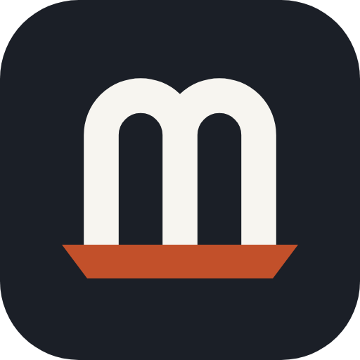

# Methodsmith brand guide

Methodsmith is a plugin for rigorous research methods: clinical statistics,
Python and machine-learning papers, and meta-analysis, from question to paper.
The brand should read like a well-kept methods section: plain, exact and
checkable. It should not read like a startup.

All assets live in [`website/static/brand/`](../../website/static/brand/) and are
rebuilt from source with:

```bash
bash docs/brand/scripts/render-brand.sh
```

The script downloads the OFL fonts to `/tmp`, writes outlined SVGs (no font
needed to view them) and exports the PNGs with headless Chrome.

## Name and voice

- Write **Methodsmith**, one word, capital M. The plugin slug is `methodsmith`
  and every command starts with `/method-`.
- Tagline: *Rigorous methods for statistics, machine learning, and
  meta-analysis, from question to paper. Every study compounds.* The second
  sentence may stand alone as a sign-off.
- "Compound" is a verb and a loop step, never the product name.
- Use the words our audience trusts: rigorous, reproducible, verified,
  transparent, audit trail, pre-specified, reporting guideline.
- Do not use: autonomous, 10x, vibe, hands-off, "AI statistician", "replaces
  your analyst". The researcher stays accountable; say so.
- Credit Every's [Compound Engineering](https://github.com/EveryInc/compound-engineering-plugin)
  as the origin of the plan -> work -> review -> compound loop wherever the loop
  is explained at length (README, docs home).

## The mark



A lowercase **m** for methods, forged on an **anvil face** for the smith. The
two arches are two passes through the loop; the ember face is the compound step
that every study rests on. It is drawn on a 64-unit grid with a 6.2-unit stroke
and holds its shape at 16 px.

| File | Use |
|---|---|
| `mark.svg`, `mark-{16..1024}.png` | App icon: ink tile, paper m, ember face. Default everywhere a square icon is needed |
| `mark-light.svg` | Tile-free mark for light backgrounds (ink m, ember face) |
| `mark-dark.svg` | Tile-free mark for dark backgrounds (paper m, glow face) |
| `favicon.svg`, `favicon.ico`, `apple-touch-icon.png` | Browser and home-screen icons (ico holds 16, 32, 48) |
| `lockup-light.svg/.png`, `lockup-dark.svg/.png` | Mark plus wordmark, horizontal |

Rules:

- Keep clear space of one arch width (14 grid units) on every side of the mark.
- Minimum size: 16 px for the tile, 20 px for the tile-free mark.
- Don't recolour the m in ember, add gradients, outlines or shadows, rotate it,
  or put the tile-free ink mark on a dark background.
- In the lockup the anvil sits on the wordmark baseline and the mark is 1.34x
  the font size. Use the files; don't rebuild the lockup by hand.

## Colour

Built on the editorial palette already used by the README diagrams and site
video (`website/animations/ce_visuals.py`): warm paper, ink type, muted phase
hues. Methodsmith adds one accent, **ember**, the colour of worked metal.

| Token | Hex | Role | Contrast (WCAG 2.x) |
|---|---|---|---|
| Ink | `#1B1F27` | Text and mark on light | 15.2:1 on Paper |
| Paper | `#F7F5F0` | Light background | — |
| Muted | `#5B6370` | Secondary text on light | 5.6:1 on Paper, 6.1:1 on white |
| Rule | `#DCD8CF` | Hairlines and borders on light | decorative |
| Ember | `#C2502A` | Accent fills: anvil face, active node, return arrow | 4.3:1 on Paper (graphics need 3:1) |
| Ember Deep | `#A63F1C` | Accent **text** and links on light | 5.8:1 on Paper, 6.3:1 on white |
| Night | `#11141A` | Dark background | — |
| Night Surface | `#1B1F27` | Cards and the icon tile on dark | — |
| Night Text | `#ECE8E0` | Text on dark | 15.1:1 on Night |
| Night Muted | `#A3AAB5` | Secondary text on dark | 7.9:1 on Night |
| Ember Glow | `#E57A50` | Accent text and fills on dark | 6.4:1 on Night, 5.7:1 on Night Surface |

Ember is never body text on light: use Ember Deep. Keep ember to one or two
marks per view; it signals "this is the compounding step" or "act here".

The six phase hues in `ce_visuals.py` (Frame `#1D4E89`, Design `#2A7F7A`,
Data `#7A5C1E`, Plan `#A61B2B`, Execute `#5B3F8C`, Review `#2F6B3B`) stay as the
categorical palette for diagrams. They are data colours, not brand colours.

## Type

All three families are open source (SIL OFL 1.1).

| Role | Family | Notes |
|---|---|---|
| Wordmark and display headings | [Source Serif 4](https://github.com/adobe-fonts/source-serif) Semibold, optical size 60 | The voice of a journal methods section. Tracking -0.012 em in the wordmark |
| Text and UI | [IBM Plex Sans](https://github.com/IBM/plex) 400 and 500 | Labels in caps get +0.08 em tracking |
| Commands, code, numbers in tables | [IBM Plex Mono](https://github.com/IBM/plex) 500 | Only for things a user types or a machine prints |

The README diagrams and video are rendered with Avenir Next and Menlo on macOS
(see `website/animations/README.md`); they share the palette, not the faces.

## Media

| Asset | File | Notes |
|---|---|---|
| README hero | `hero-light.svg`, `hero-dark.svg` (+ PNG) | 1600x560. Use a `<picture>` element so GitHub picks the theme |
| GitHub social preview | `social-preview.png` | 1280x640, under 1 MB. Upload in repository Settings (it cannot be set through the API) |
| Plugin directory icon | `plugins/<plugin>/assets/icon.png` and `icon.svg` | 512x512 square, used by the Claude `icon` and Codex `logo`/`composerIcon` fields |

## The loop graphic

The hero and social card show the loop as four nodes in a row: Plan, Work,
Review, Compound. Compound is the only ember node, and an ember return line
runs back to Plan labelled "learnings feed the next plan". That return line is
the brand's one recurring device; use it wherever the loop is drawn, and don't
add other decorative curves.
