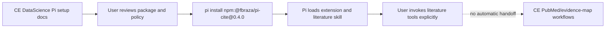

# feat: Add pi-cite as a pinned Pi literature add-on

## Goal Capsule

- **Objective:** Make `@fbraza/pi-cite` a documented, discoverable optional add-on for CE DataScience's Pi setup.
- **Authority:** The user's named Pi package page is authoritative for the package identity and install shape; repository conventions control how optional Pi dependencies are documented and verified.
- **Execution profile:** Small cross-cutting documentation and generated-install guidance change; do not vendor or auto-execute third-party package source.
- **Stop conditions:** Stop if the package install contract or peer-dependency requirements materially differ from the verified 0.4.0 package metadata, or if adding it would require changing the generic Pi converter architecture.
- **Tail ownership:** After implementation, run the Pi/documentation checks and leave the user with a clean, reviewable diff; no automatic release or merge.

---

## Product Contract

### Summary

CE DataScience already supports Pi through generated skills, agents, prompts, and separately installed community extensions. Users who want PubMed and Zotero literature tools should be able to discover and install the named `@fbraza/pi-cite` package from the repository's Pi setup guidance without mistaking it for a bundled CE component.

### Problem Frame

The repository documents `pi-subagents` and `pi-ask-user` but has no first-class guidance for the named literature extension. Copying its executable source into the CE plugin would create a third-party maintenance and supply-chain surface, while silently installing it would violate the repository's existing rule that optional integrations remain user-configured.

### Requirements

- R1. Pi setup guidance identifies `@fbraza/pi-cite` as an optional external literature add-on and uses the pinned verified version `0.4.0`.
- R2. Guidance preserves the package's install model: `pi install npm:@fbraza/pi-cite@0.4.0`, with an explicit note that users should review third-party package source before installation.
- R3. Guidance explains the package's relevant capabilities — PubMed search, Zotero search, and the bundled `literature` skill — without claiming that CE automatically converts its results into CE artifacts.
- R4. CE does not vendor the package's executable extension source, auto-install it, add it to the Claude plugin manifest, or change the generic Pi converter solely to support this add-on.
- R5. Documentation and Pi-generated compatibility guidance remain synchronized and continue to distinguish required, recommended, and optional external Pi packages.

### Scope Boundaries

#### In scope

- Add the pinned `pi-cite` install path to Pi setup documentation and the generated Pi compatibility block.
- Document optional `NCBI_API_KEY` and Zotero configuration only at the level needed to discover the add-on safely.
- Add focused assertions that the public Pi guidance and generated compatibility text stay aligned.

#### Deferred to Follow-Up Work

- Vendoring or forking `pi-cite` source into this repository.
- Translating `literature_search`, `pubmed_search`, or `zotero_search` outputs into CE-native CSV, evidence-map, SAP, or manuscript artifacts.
- Maintaining a CE-specific replacement for the package's bundled `literature` skill.

#### Outside This Product's Identity

- Automatic installation or authentication of third-party Pi extensions.
- Unreviewed forwarding of protected health information, private manuscripts, or confidential research queries to PubMed, Zotero, or other external services.

---

## Planning Contract

### Key Technical Decisions

- KTD1. **Keep `pi-cite` external and pinned:** Treat the package like the existing Pi prerequisites, because the repository already separates generated CE content from user-configured third-party extensions and the package executes code in the Pi host.
- KTD2. **Document, do not auto-install:** Update the Pi compatibility block and canonical setup docs, but leave installation as an explicit user action so offline, corporate, and privacy-sensitive users retain control.
- KTD3. **Do not alter the generic converter:** The package is a Pi-native extension/skill bundle, not a Claude plugin component. Adding special-case converter behavior would expand the target contract without a demonstrated need.

### High-Level Technical Design

The repository remains the source of CE workflow guidance. Pi remains the source of package installation and runtime loading. The add-on's literature results remain direct Pi capabilities unless a future, separately scoped handoff contract is designed and tested.

### Assumptions

- The requested target is the current Pi integration surface in this repository, not a new Claude skill or a vendored fork.
- `@fbraza/pi-cite@0.4.0` remains the reviewed package version for this change; later upgrades require a new verification pass.
- Pi users can install npm packages and satisfy the package's declared peer dependencies through their Pi host environment.

---

## Implementation Units

### U1. Add pinned pi-cite guidance to Pi setup surfaces

- **Goal:** Make the named package discoverable and safely installable wherever CE documents Pi setup.
- **Requirements:** R1, R2, R3, R4, R5.
- **Dependencies:** None.
- **Files:**
  - `src/targets/pi.ts`
  - `docs/setup.md`
  - `plugins/ce-datascience/README.md`
  - `README.md`
- **Approach:**
  - Add `@fbraza/pi-cite@0.4.0` to the generated Pi compatibility block as an optional literature add-on, after the existing required/recommended extensions.
  - Add a short Pi setup subsection with the pinned install command, package capabilities, third-party review warning, and optional environment-variable guidance.
  - Keep the wording explicit that the add-on is external, user-installed, and not an automatic CE artifact handoff.
- **Patterns to follow:** Existing Pi prerequisite guidance in `src/targets/pi.ts`, `docs/setup.md`, and the plugin/root README setup sections; existing Paperclip and PubMed add-on privacy boundaries.
- **Test scenarios:**
  - Generated Pi `AGENTS.md` compatibility text contains the pinned `pi install npm:@fbraza/pi-cite@0.4.0` command and labels it optional.
  - Canonical setup documentation names PubMed/Zotero/literature capabilities and does not claim automatic CE artifact translation.
  - Root README and plugin README retain synchronized Pi install wording and continue to mention the existing `pi-subagents` prerequisite.
  - Documentation does not instruct the installer or converter to fetch, authenticate, or execute `pi-cite` automatically.
- **Verification:** Generated Pi compatibility output and documentation assertions pass; no generic converter or plugin manifest change is required.

### U2. Add focused contract coverage for the optional Pi add-on

- **Goal:** Prevent future Pi setup edits from dropping the pinned add-on boundary or accidentally bundling it.
- **Requirements:** R3, R4, R5.
- **Dependencies:** U1.
- **Files:**
  - `tests/pi-converter.test.ts`
  - `tests/corporate-install.test.ts`
  - `tests/platform-smoke.test.ts`
- **Approach:** Extend the existing Pi and documentation/install assertions rather than introducing a new test harness. Prove that normal CE conversion still emits no bundled Pi extension and that the generated compatibility block contains only guidance for the optional package.
- **Patterns to follow:** Existing `bundle.extensions` assertions in `tests/pi-converter.test.ts` and generated-install checks in `tests/corporate-install.test.ts` and `tests/platform-smoke.test.ts`.
- **Test scenarios:**
  - Converting the CE plugin still emits no bundled `pi-cite` extension or package source.
  - Pi install smoke output remains loadable and contains the managed compatibility block with the optional add-on wording.
  - Corporate/offline packaging contains documentation only and does not introduce an npm install or third-party executable payload.
- **Verification:** Focused Pi, corporate-install, and platform-smoke tests pass without changing the converter's existing MCP or extension contracts.

---

## Risks & Dependencies

- **Third-party package drift:** The package page currently reports version 0.4.0, MIT license, three Pi peer dependencies, and optional PubMed/Zotero environment variables. Pinning the version limits silent drift; future updates need a fresh package review.
- **Supply-chain risk:** Pi packages can execute code and influence agent behavior. The docs must retain the package site's source-review warning and must not auto-install it.
- **Privacy risk:** Literature queries and Zotero access can expose sensitive research context. Guidance must keep the existing CE prohibition on sending PHI, credentials, private manuscripts, or confidential queries without approval.
- **Handoff ambiguity:** `pi-cite` results are direct Pi capabilities, not CE `__CE_PUBMED_RESULTS__` or evidence-map artifacts. The docs must state this boundary clearly.

---

## Sources & Research

- [Pi package page for `@fbraza/pi-cite`](https://pi.dev/packages/@fbraza/pi-cite) — verified package identity, install command, version 0.4.0, MIT license, extension/skill manifest, capabilities, peer dependencies, and environment variables.
- `src/targets/pi.ts` — existing managed Pi compatibility block and external-extension guidance.
- `src/converters/claude-to-pi.ts` — existing converter behavior; no bundled Pi extension is emitted.
- `tests/pi-converter.test.ts` — existing contract that Pi conversion preserves external MCP handling but emits no bundled extension.
- `docs/setup.md` — current Pi install and privacy boundaries.

---

## Verification Contract

| Gate | Applies when | Done signal |
|---|---|---|
| TypeScript check | Any source change | `bunx tsc --noEmit` passes. |
| Pi converter and writer tests | U1/U2 | `bun test tests/pi-converter.test.ts tests/platform-smoke.test.ts` passes. |
| Corporate documentation/install tests | U1/U2 | `bun test tests/corporate-install.test.ts` passes, apart from any separately documented pre-existing root README fixture failure. |
| Release metadata validation | Plugin/docs inventory or generated compatibility changes | `bun run release:validate` passes with no count or manifest drift. |
| Diff hygiene | All units | `git diff --check` passes and no package source, credentials, or generated caches are added. |

---

## Definition of Done

- [ ] The pinned `pi-cite` install command appears in the generated Pi compatibility guidance and canonical Pi setup docs.
- [ ] Documentation identifies the package as optional, external, third-party executable code and preserves privacy review requirements.
- [ ] Documentation distinguishes the package's direct literature capabilities from CE-native artifact handoffs.
- [ ] No `pi-cite` source, npm tarball, auto-install hook, plugin manifest entry, or generic converter special case is added.
- [ ] Focused tests, TypeScript validation, release validation, and diff hygiene pass.
- [ ] No abandoned experimental files or generated caches remain in the diff.

