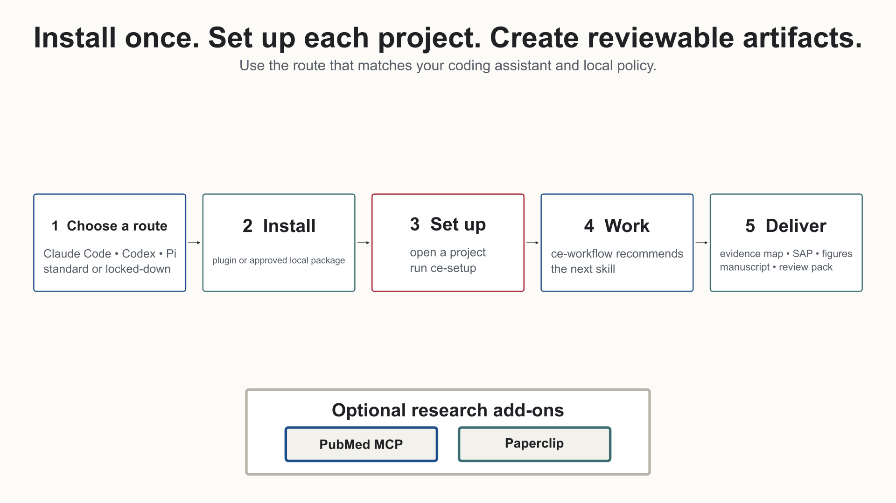

# CE DataScience Setup Guide

This guide is the fastest path from a fresh machine to a working `ce-datascience`
install. Use Bash on macOS, Linux, WSL, or Git Bash. Use PowerShell on native
Windows.

## Visual Overview




[Watch the workflow overview](https://sajor2000.github.io/ce-datascience/media/ce-datascience-overview.mp4)

## OS Support Matrix

| OS | Recommended shell | Easiest command | Notes |
|---|---|---|---|
| macOS | Bash or Zsh | `bash install.sh claude --aliases` or `bash install.sh codex` | Fully supported and tested locally on macOS. |
| Linux | Bash | `bash install.sh claude --aliases` or `bash install.sh codex` | Covered by Bash syntax tests and temp-root install tests. |
| Windows with WSL | Bash inside WSL | `bash install.sh claude --aliases` or `bash install.sh codex` | Use Linux paths inside WSL, such as `/mnt/c/...` only when needed. |
| Windows with Git Bash | Git Bash | `bash install.sh claude --aliases` or `bash install.sh codex` | `C:/Users/...` paths are accepted by the Bash helper. |
| Windows PowerShell | PowerShell | `.\install.ps1 claude -Aliases` or `.\install.ps1 codex` | Native Windows path handling and Codex offline install support. |

## Choose Your Install Route

If you have a source checkout, run the read-only install check first:

```bash
bash install.sh doctor
```

On Windows PowerShell, use:

```powershell
.\install.ps1 doctor
```

The check reports whether the checkout or approved artifact is recognized and
whether the local Claude, Codex, and optional Bun tools are available. Use the
standard route below on a personal or managed laptop that can run Git and the
agent CLI. On a locked-down or corporate laptop, skip source-build tooling and
use the approved offline artifact route in section 2.

## 1. Easiest Install Path

This mirrors the original Compound Engineering plugin experience: install once,
then run setup.

### Claude Code

No checkout needed (Claude Code 2.1.275 or later): install straight from the
GitHub marketplace, then start Claude Code.

```bash
claude plugin install ce-datascience --marketplace sajor2000/ce-datascience
claude
```

The same one-step install works inside a running Claude Code session:

```text
/plugin install ce-datascience --marketplace sajor2000/ce-datascience
```

From a source checkout (also adds the optional bare `/ce-*` aliases), on macOS,
Linux, WSL, or Git Bash:

```bash
git clone https://github.com/sajor2000/ce-datascience.git ~/ce-datascience
cd ~/ce-datascience
bash install.sh claude --aliases
claude
```

Windows PowerShell:

```powershell
git clone https://github.com/sajor2000/ce-datascience.git "$HOME\ce-datascience"
cd "$HOME\ce-datascience"
.\install.ps1 claude -Aliases
claude
```

Then open the target project and run:

```text
/ce-datascience:ce-setup
```

The helper adds the GitHub marketplace, installs the plugin, and turns on
auto-update (see [Keep CE DataScience updated](#keep-ce-datascience-updated)).
Pass `--source .` to use the checkout as a local marketplace instead. The
namespaced command is the reliable default. `--aliases` is optional and adds
safe local bare `/ce-*` demo commands.

### Codex

macOS, Linux, WSL, or Git Bash:

```bash
git clone https://github.com/sajor2000/ce-datascience.git ~/ce-datascience
cd ~/ce-datascience
bash install.sh codex
codex
```

Windows PowerShell:

```powershell
git clone https://github.com/sajor2000/ce-datascience.git "$HOME\ce-datascience"
cd "$HOME\ce-datascience"
.\install.ps1 codex
codex
```

Inside Codex, run `/plugins`, install **CE DataScience**, restart Codex, then
start a new thread and ask Codex to use CE DataScience for setup. If Bun is
available, the helper also installs the generated CE agents into the selected
`CODEX_HOME`.

### Pi

Pi uses the generated installation path rather than a native marketplace.

```bash
pi install npm:pi-subagents
pi install npm:pi-ask-user
cd ~/ce-datascience
bun run src/index.ts install ./plugins/ce-datascience --to pi --pi-home "$HOME/.pi/agent"
```

Restart Pi, open the project, and invoke `ce-setup` using Pi's normal skill
interface. `pi-subagents` is required for CE subagent workflows; `pi-ask-user`
is recommended for the compact setup confirmation.

### What the easy installer does

| Target | Installer action | Required finish |
|---|---|---|
| Claude Code | Adds the GitHub marketplace (or this checkout with `--source`), installs `ce-datascience`, turns on auto-update, and optionally creates managed bare `/ce-*` aliases | Restart Claude Code, open the project or study directory, then run `/ce-datascience:ce-setup` or the optional `/ce-setup` alias |
| Codex | Adds the GitHub marketplace (or this checkout with `--source`) so `codex plugin marketplace upgrade` works and, when Bun is available, writes the generated agent bridge into the selected `CODEX_HOME` | Restart Codex, open `/plugins`, install **CE DataScience**, restart again, then start a new task in the target project |
| Pi | Writes generated CE skills and agents under the selected Pi home, plus a managed block in that root's `AGENTS.md` | Install `pi-subagents`, restart Pi, open the target project, then invoke `ce-setup` |

The installer does not configure every research project globally. The
`ce-setup` skill creates project-local configuration after the plugin is loaded.
Run setup again when a different project uses a different language, IDE, data
layer, or reporting workflow.

### Keep CE DataScience updated

How a new version reaches you depends on the agent.

| Agent | Automatic? | Update by hand |
|---|---|---|
| Claude Code | Yes, once auto-update is on for the `ce-datascience-plugin` marketplace. `bash install.sh claude` and `.\install.ps1 claude` turn it on (add `--no-auto-update` or `-NoAutoUpdate` to skip). After a one-line `claude plugin install ... --marketplace sajor2000/ce-datascience`, turn it on yourself: run `/plugin`, open **Marketplaces**, select `ce-datascience-plugin`, and choose **Enable auto-update**. | `claude plugin update ce-datascience@ce-datascience-plugin`, then `/reload-plugins` |
| Codex | No. Codex has no documented automatic plugin update. | `codex plugin marketplace upgrade ce-datascience-plugin`, then restart Codex. Refresh the generated agents with `bunx ce-datascience-plugin@latest install ce-datascience --to codex` |
| OpenCode, Pi, Gemini CLI, Kiro | No. These use generated files. | `bunx ce-datascience-plugin@latest install ce-datascience --to opencode` (or `--to pi`, `--to gemini`, `--to kiro`; add `--output <workspace>` for a project install) |
| Qwen Code | No. | `qwen extensions update ce-datascience` |
| Local checkout or offline package | No. | `git pull` in the checkout (or unpack the new package), then re-run the installer |

With auto-update on, Claude Code checks in the background a few minutes after
your first message and shows `Plugin updated ... Run /reload-plugins to apply`.
Your current session keeps the version it started with. A marketplace added
from a local folder never auto-updates, because Claude Code loads that folder
in place; that is why the installers now add the GitHub marketplace unless you
pass `--source`. Setting `DISABLE_AUTOUPDATER=1`, `DISABLE_UPDATES=1`, or
`CLAUDE_CODE_DISABLE_NONESSENTIAL_TRAFFIC=1` turns the background update off
unless you also set `FORCE_AUTOUPDATE_PLUGINS=1`.

Not sure which command applies? Run the `ce-update` skill (`/ce-update` in
Claude Code). It prints the exact command for the agent you are in.

### Your own skills are safe

Updates never delete or overwrite skills, agents, prompts, or commands you
created.

- Generated installs (Codex agents, OpenCode, Pi, Gemini CLI, Kiro) record
  every file they write, with a content hash, in
  `<agent folder>/ce-datascience/owned-files.json`. An update deletes only
  unchanged files on that list.
- Files from an install made before ownership tracking are not on the list.
  The installer treats one as the plugin's only when its install record or its
  exact description shows ce-datascience wrote it, and then moves it to
  `<agent folder>/ce-datascience/backups/` or `legacy-backup/` instead of
  deleting it. This includes Codex's retired `~/.codex/ce-datascience/skills`
  folder.
- If you edited a file the plugin installed, the update copies your version to
  `<agent folder>/ce-datascience/backups/<time>/` before replacing it.
- A file the plugin did not write is left alone, even when it has the name of
  an old ce-datascience skill such as `setup` or `skill-creator`. The installer
  prints one line saying it kept the file.
- Claude Code keeps the plugin in its own plugin cache under `~/.claude/plugins/`,
  replaces that copy on every update, and deletes old versions later, so never
  keep your own files there.

Keep your own skills here:

| Agent | For you, in every project | For one project |
|---|---|---|
| Claude Code | `~/.claude/skills/<name>/SKILL.md` | `.claude/skills/<name>/SKILL.md` |
| Codex | `~/.agents/skills/<name>/SKILL.md` | `.agents/skills/<name>/SKILL.md` |
| OpenCode | `~/.config/opencode/skills/<name>/SKILL.md` | `.opencode/skills/<name>/SKILL.md` |
| Pi | `~/.pi/agent/skills/<name>/SKILL.md` | `.pi/skills/<name>/SKILL.md` |
| Gemini CLI | `~/.gemini/skills/<name>/SKILL.md` | `.gemini/skills/<name>/SKILL.md` |
| Kiro | Not covered here | `.kiro/skills/<name>/SKILL.md` |
| Qwen Code | `~/.qwen/skills/<name>/SKILL.md` | `.qwen/skills/<name>/SKILL.md` |

Do not start your own skill names with `ce-`. That prefix belongs to the
plugin; if a name is already taken by your own skill, the installer skips the
plugin's version and tells you.

### What setup asks

Setup inspects manifests, lockfiles, notebooks, imports, IDE files, existing CE
configuration, verified database handoffs, and data-file patterns first. It
shows a single detected-profile card and offers **Continue with detected
profile**, **Adjust a field**, or **Full survey**. The normal path leaves
optional library, statistics, environment, reporting, data-root, blinding, and
checklist choices unset until the active workflow needs them; unknown language
is never silently treated as mixed R + Python.

### Sensitive-data boundary

Before setup looks at any data, `ce-setup` asks one question and saves the
answer as `phi_environment.mode` in the gitignored, machine-local
`.ce-datascience/config.local.yaml`:

| Answer | Saved as | What happens |
|---|---|---|
| **Approved endpoint: full access** (HIPAA-compliant with a BAA, or institution-approved) | `mode: approved` | No restrictions on the model for the rest of the session. The agent never raises the boundary again. You are responsible for that approval. |
| **Not approved or unsure: schema-only** (also used when no answer is saved, or the saved value cannot be read) | `mode: schema-only` | The agent sees column headings, types, row counts, and % missing, never data values such as names, MRNs, or claim numbers. It writes scripts that print only aggregates, with counts under 11 suppressed. It cannot inspect example rows, debug value-level parsing or join mismatches by example, read free text, or spot individual entry errors. |
| **No sensitive data: public or synthetic** | `mode: no-sensitive-data` | No restrictions, never raised again. |

Older configs keep working: `compliant: true` reads as `approved`,
`compliant: false` as `schema-only`, and `sensitive_data: false` as
`no-sensitive-data`. If the keys disagree, any schema-only signal wins.

**What enforces it.** In Claude Code, a plugin `PreToolUse` hook
(`hooks/data-boundary-guard.py`) runs only inside projects that have a
`.ce-datascience/` directory, in the working tree or the main checkout of a
linked worktree. It is silent unless it blocks a call. In schema-only mode it
denies:

- `Read`, `NotebookRead`, and content-mode `Grep` on data files. Data files are
  `.csv`, `.tsv`, `.parquet`, `.xlsx`, `.sas7bdat`, `.dta`, `.rds`, `.sqlite`,
  `.jsonl`, and similar, including compressed or backup copies (`.csv.gz`,
  `.csv.bak`), plus anything under the configured `data_root` and the safe
  runner's logs. A notebook with saved outputs also counts; clear its outputs
  first.
- Any shell command (`Bash`, `Monitor`, `PowerShell`) whose text names a data
  path, an extension glob, or `data_root`, whatever the program, unless it only
  lists metadata (`ls`, `wc`, `du`, `find`, `git status`/`log`) or runs the
  schema helper. Inline code (`python -c`, `Rscript -e`, heredocs) that opens
  data or globs a data directory, writing a script and running it in the same
  command, copying a data file to a non-data name, and recursive `grep`/`rg`
  without an `--include`/`-g`/`-t` limited to code are denied too.
- Running a script file (`python`, `Rscript`, `bash`/`sh`, `quarto render`,
  `jupyter nbconvert --execute`) whose code names a data path or `data_root`,
  or calls a reader (`read_csv`, `read_parquet`, `read_excel`, `read_sas`,
  `read_stata`, `fread`, `readRDS`, `arrow::`, DuckDB, SQLite) on a path held
  in a variable, unless the command runs through the safe runner. The hook
  reads the script itself, up to 1 MB. Scripts that do not touch data, or that
  only read aggregate tables that pass the check below, run as before.

**Safe runner.** `scripts/ce-safe-run -- <command>` runs the command and writes
its full stdout and stderr to `.ce-datascience/runs/<UTC-timestamp>-<pid>.log`
(gitignored). It prints only the exit code, the duration, the files created or
modified under the project (path, size, and row count for tabular files), and
the last 30 lines of stderr with quoted literals, digit runs of 4 or more,
emails, phone numbers, SSNs, and identifier-index values masked. Traceback file
and line frames stay readable. It never prints stdout: open the log yourself.
The hook's deny message gives the runner's full path. It accepts only the
plugin's own runner (or a byte-identical copy) and still checks uploads inside
it.

**Aggregate reads.** `Read`, `cat`, `head`, and `tail` of `.csv`, `.tsv`, and
`.md` files under the aggregate directories are allowed in schema-only mode
when the table passes the aggregate check: no identifier-like column headings,
no cell in the identifier index or shaped like an identifier, no integer count
from 1 to 10 (the small-cell rule; 0 is fine), and at most 500 rows. Otherwise
the deny reason names the rule that failed, never the value. The directories
default to `output`, `results`, `analysis/publication`, and
`analysis/sap-tables`; set `phi_environment.aggregate_dirs` to change them.
`data_root` always wins: nothing under it is readable.

The schema helper `scripts/schema-peek.py` prints headings, types, counts, and
% missing, never a cell value. It prints `col_1..col_n` when a file has no
header row, and `col_<k> [masked header]` for a heading that is itself an
identifier (an identifier shape, or a value in the identifier index).

#### What MCP tools receive

PubMed, Paperclip, and every other MCP tool receive search terms, MeSH terms,
PMIDs, DOIs, and paper titles. They never receive data values, identifiers,
row text, or data files. This holds in **every mode, including after you
approve the endpoint**: approving the model endpoint does not cover
third-party services such as NCBI or Paperclip.

The same hook enforces this for every `mcp__*` call, for shell uploads, and for
shell calls to NCBI E-utilities (`curl` or `wget` to
`eutils.ncbi.nlm.nih.gov`, and the `ce-pubmed` search script). It denies
arguments that contain an SSN, an email address, a US phone number, a
keyword-anchored record number (MRN, medical record, patient ID, member ID,
claim number), a keyword-anchored date of birth, or a value in the identifier
index. It also denies Paperclip upload, import, or share calls that name a
local data file, and `curl`, `wget`, `scp`, or `rsync` uploads of data files.
PMIDs, DOIs, PMCIDs, author surnames, and ordinary research queries pass
silently. The skills carry the same rule.

**Identifier index.** Whenever `data_root` is set, in every mode, `ce-setup`
builds and `ce-data-qa` refreshes the identifier index with
`scripts/ce-identifier-index`. It reads identifier-like columns under
`data_root` (names; MRN, patient, member, subscriber, and record IDs; claim
numbers; SSN; date of birth; address; phone; email) and stores only salted
hashes in `.ce-datascience/identifier-index.local.json`: local, gitignored,
with a random per-project salt and no plaintext. It prints counts only. Each
full value is stored, plus first+last name pairs, plus single tokens that
contain a digit for ID columns only, so a lone surname or common word never
matches. The hook hashes every one- to three-word run of each argument, denies
on a match without echoing it, and is silent when no index exists. With a
200,000-entry index the lookup adds a few milliseconds.

**Limits.** The hook is defense in depth, not a sandbox. Enforcement is Claude
Code only: Codex and OpenCode installs carry the hook entry but it exits
immediately there, and Gemini, Kiro, Copilot, and Pi skip hooks, so those
harnesses rely on the skill instructions alone. The script check is heuristic
static analysis: a script that builds a data path at run time, or reads data
through a function the hook does not recognize, can still print values, and
programs it cannot parse (deliberate obfuscation) are out of scope. Values
that are not in identifier columns, such as free-text notes, are not indexed,
and the identifier patterns catch common shapes, not every one. A patient who
shares a full name with an author you search for blocks that name. A config
problem resolves to schema-only. An unexpected internal error blocks only
calls that mention a data file or an upload; anything else is allowed with a
one-line warning, so a hook bug never blocks unrelated work.

**Changing the answer.** Re-run `ce-setup`, or edit or delete the
`phi_environment` block in `.ce-datascience/config.local.yaml`.

## 2. Locked-Down Or Demo Laptop

### Locked-down laptop or team demo

Use this path when Bun, Git, GitHub CLI, Homebrew, npm, or Quarto are blocked.
Basic plugin use does not require those tools.

Ask IT or the release owner for one of these approved artifacts:

- `ce-datascience-plugin.zip` for Claude Code
- `ce-datascience-claude-aliases.zip` for optional bare `/ce-*` aliases
- `ce-datascience-codex-local.zip` for Codex local marketplace installs

Claude Code can load either an approved folder or ZIP:

```bash
claude --plugin-dir /approved/path/ce-datascience
claude --plugin-dir /approved/path/ce-datascience.zip
```

Use namespaced Claude plugin commands:

```text
/ce-datascience:ce-setup --locked-down
/ce-datascience:ce-workflow
```

Bare `/ce-setup` is not guaranteed by Claude plugin loading. It works only when
optional local aliases are installed into `~/.claude/commands` or a project's
`.claude/commands`.

To install optional aliases from an approved plugin folder:

```bash
bash scripts/install/install-claude-aliases.sh --plugin-dir /approved/path/ce-datascience --scope user
```

For project-only aliases, run from the project root:

```bash
bash scripts/install/install-claude-aliases.sh --plugin-dir /approved/path/ce-datascience --scope project
```

To remove only managed CE aliases:

```bash
bash scripts/install/install-claude-aliases.sh --scope user --uninstall
```

For Codex without Bun, unpack `ce-datascience-codex-local.zip` and run:

```bash
export CODEX_HOME="${CODEX_HOME:-$HOME/.codex}"
bash install-codex-offline.sh --source /approved/path/ce-datascience-codex-local --codex-home "$CODEX_HOME"
```

On Windows PowerShell:

```powershell
.\install.ps1 codex -Source C:\approved\ce-datascience-codex-local -CodexHome "$HOME\.codex"
```

Then restart Codex, run `/plugins`, install CE DataScience from the local
marketplace, and restart again. The installer also writes generated agent bridge
files into the selected `CODEX_HOME`, copies the native plugin under the
marketplace root at `.codex/plugins/ce-datascience`, and rewrites MCP paths to
that installed local plugin copy. The marketplace entry uses
`source.path: "./.codex/plugins/ce-datascience"` so Codex can resolve it from
the marketplace root.

## 3. Source Checkout For Contributors

Bun and Git are required only when building, validating, converting, or
developing the plugin from source.

## 4. Install Source Prerequisites

Install Bun if it is not already available:

```bash
curl -fsSL https://bun.sh/install | bash
```

Restart the shell, then verify:

```bash
bun --version
```

## 5. Clone Once

Clone the repo and install dependencies:

```bash
export CE_DS_REPO="$HOME/ce-datascience"
git clone https://github.com/sajor2000/ce-datascience.git "$CE_DS_REPO"
cd "$CE_DS_REPO"
bun install
```

Optional sanity check:

```bash
bun run release:validate
```

Expected result: release metadata is in sync, with the current agent and skill
counts.

## 6. Pick Your Agent

### Claude Code

Load the plugin directly from the checkout:

```bash
claude --plugin-dir "$CE_DS_REPO/plugins/ce-datascience"
```

Optional shell shortcut:

```bash
printf "\nalias claude-ds='claude --plugin-dir %s/plugins/ce-datascience'\n" "$CE_DS_REPO" >> ~/.zshrc
source ~/.zshrc
```

Then run `claude-ds` from any project.

In Claude Code, use namespaced plugin commands such as
`/ce-datascience:ce-setup`. Install optional local aliases only if you need bare
demo commands such as `/ce-setup`.

### Codex, Recommended Mode

Use Codex native plugin install for skills, then add generated agents with the
Bun installer. Use the same `CODEX_HOME` for both commands.

```bash
export CE_DS_REPO="$HOME/ce-datascience"
export CODEX_HOME="$HOME/.codex"

codex plugin marketplace add "$CE_DS_REPO"
cd "$CE_DS_REPO"
bun run src/index.ts install ./plugins/ce-datascience --to codex --codex-home "$CODEX_HOME"
codex
```

Inside Codex, run `/plugins`, select the local marketplace, install
`ce-datascience`, then restart Codex.

For a separate research profile:

```bash
export CODEX_HOME="$HOME/.codex/profiles/research"
codex plugin marketplace add "$CE_DS_REPO"
cd "$CE_DS_REPO"
bun run src/index.ts install ./plugins/ce-datascience --to codex --codex-home "$CODEX_HOME"
CODEX_HOME="$CODEX_HOME" codex
```

### Codex, Standalone Generated Mode

Use this when native Codex plugin install is unavailable:

```bash
cd "$CE_DS_REPO"
bun run src/index.ts install ./plugins/ce-datascience --to codex --codex-home "$CODEX_HOME" --include-skills
```

Standalone mode writes generated skills and agents. Managed `.codex/hooks.json`
entries are written only for plugins that declare hooks (CE DataScience
currently declares none); when present they preserve manual hooks and hooks
from other plugins. Optional MCP integrations remain user-configured.

Both Codex modes also write a managed `CE DATASCIENCE CODEX TOOL MAP` block to
`$CODEX_HOME/AGENTS.md`. The `ce-setup` health check reports only the retired
`COMPOUND CODEX TOOL MAP` block from older installs; re-running the installer
for the same `CODEX_HOME` replaces it.

### OpenCode

Install into the workspace where OpenCode should load the plugin:

```bash
cd "$CE_DS_REPO"
bun run src/index.ts install ./plugins/ce-datascience --to opencode --output /path/to/workspace
```

This writes `opencode.json` plus `.opencode/agents` and `.opencode/skills` under
the workspace (`.opencode/plugins` appears only when the plugin declares hooks;
CE DataScience currently declares none). If the output directory itself is
named `opencode` or `.opencode`, the writer treats it as a global OpenCode
config root and writes a flat layout instead.

### Gemini CLI

```bash
cd "$CE_DS_REPO"
bun run src/index.ts install ./plugins/ce-datascience --to gemini --output /path/to/gemini-workspace
```

This writes `.gemini/skills` and `.gemini/agents`. `.gemini/settings.json` is
merged only when the plugin declares MCP servers; CE DataScience declares none.

### Kiro

```bash
cd "$CE_DS_REPO"
bun run src/index.ts install ./plugins/ce-datascience --to kiro --output /path/to/kiro-workspace
```

This writes `.kiro/skills`, `.kiro/agents`, and a `.kiro/steering` file. MCP
settings are written only when the plugin declares MCP servers; CE DataScience
declares none.

### Pi

Install the external Pi subagent prerequisite, then generate Pi files:

```bash
pi install npm:pi-subagents
cd "$CE_DS_REPO"
bun run src/index.ts install ./plugins/ce-datascience --to pi --pi-home "$HOME/.pi/agent"
```

`pi-subagents` is required for CE workflows that delegate work. Add
`pi install npm:pi-ask-user` when you want Pi's compact blocking-question UI;
without it, skills use their documented numbered-choice fallback.

### Qwen Code

Qwen Code uses its native extension installer:

```bash
qwen extensions install sajor2000/ce-datascience:ce-datascience
```

Qwen is not a generated `--to qwen` target. `--to all` only writes generated
targets that are detected on the machine.

### Cursor, Copilot, and Droid

These tools load plugins through their own marketplace or plugin install flows
and are not generated converter targets; `--to cursor`, `--to copilot`, and
`--to droid` exit with a message that says so. The repo ships a Cursor
marketplace manifest (`.cursor-plugin/marketplace.json`) for Cursor's native
plugin install.

## 7. First Run In A Project

Installation and project setup are separate. First restart the agent, then open
the project or study directory where you want help.

For Claude Code, run the native namespaced skills:

```text
/ce-datascience:ce-setup
/ce-datascience:ce-workflow
```

If optional aliases were installed, the bare forms `/ce-setup` and
`/ce-workflow` work too. The namespaced form is the reliable default for a
native Claude plugin install.

For Codex, start a new task in the project and ask:

```text
Use the CE DataScience ce-setup skill for this project.
Then use the CE DataScience ce-workflow skill and recommend the next step.
```

For generated targets such as OpenCode, Gemini CLI, Kiro, and Pi, restart the
agent after generation, open the output workspace, and invoke the generated
`ce-setup` and `ce-workflow` skills using that agent's normal skill interface.

`ce-setup` inspects the current project and records its stack profile.
`ce-workflow` reads that profile and existing artifacts, shows the ordered
lifecycle for the project type, data layer, and language, and recommends the
next safe skill. Neither skill performs an analysis merely because the plugin
was installed; the user chooses the next workflow action.

The first pass is evidence-first: setup and workflow inspect existing config,
lockfiles, notebooks, IDE files, SAP artifacts, and recent verified connection
handoffs before asking. Follow-up questions should be limited to decisions that
change generated config, routing, or scientific scope.

### Current workflow safeguards

The September 2026 upstream refresh tightened shared engineering behavior
without replacing CE DataScience's SAP, PHI, real-data, or reporting rules:

- `ce-plan` begins its summary with an implementation-independent objective so
  the intended outcome remains stable when the implementation changes.
- `ce-work` sends parallel work only from a verified tracked snapshot. Tasks
  that depend on uncommitted files remain inline or serial so workers do not
  act on stale code.
- `ce-optimize` runs parallel Codex experiments in separate directories and
  compares them against a recorded baseline and named metric.
- `ce-debug` redacts secrets from captured evidence and repeats the original
  correctness or performance measurement after a fix.
- `ce-commit` and `ce-commit-push-pr` use a temporary Git index for named-file
  commits, preserving unrelated staged entries and later working-tree edits.
- `ce-code-review` applies `CODING_STANDARDS.md` only where its path scope
  matches, while repository instructions remain authoritative.
- `ce-setup` reports obsolete Codex tool-map blocks and asks before cleanup.

### Numbers locked to raw data

Clinical journals, reviewers, and data-sharing audits ask where each number in a
paper came from. `/ce-numbers` makes that answer checkable: a rigor signal, not a
style rule. Analysis code registers aggregates in
`analysis/numbers/registry.json` (R or Python; counts from 1 to 10 are stored
suppressed). The manuscript cites them as `{{num:<id>}}`. A gate fails the
submission when a number can't be traced. Each number follows one chain:
SAP output -> script@commit -> source file hash -> registry entry -> sentence.

Worked example (synthetic):

```r
# analysis/primary_cox.R, committed before it runs
source("analysis/numbers/ce_numbers.R")
register_number("primary.hr", 0.781, kind = "estimate", ci = c(0.664, 0.918),
                sources = "data/analytic.parquet", sap_output = "A3_cox_primary.csv")
```

```text
manuscript/results.qmd:  The hazard ratio was {{num:primary.hr}}.
rendered:                The hazard ratio was 0.78 (95% CI, 0.66-0.92).
gate on a typed number:  manuscript/abstract.md:7: untraced number: 0.81
gate after a data pull:  registry:primary.hr: stale: source data/analytic.parquet changed
```

The gate also fails on unknown ids, unsuppressed small cells, entries without a
SAP output or committed script, and when it found nothing to check. It allows
years, citation markers, figure, table, and item numbers, dates, quoted
guideline text, and the doses or units you declare. Table 1, figure captions,
model cards, and scientific writing cite the registry; `ce-verify`,
`ce-pre-submission-audit`, and `ce-manuscript-package` run the gate and fail
closed. Word manuscripts keep each number as a registry-owned field
(`ADDIN CE_NUM <id>`, beside Zotero's citation fields);
the gate fails a field whose text was hand-edited, and a number typed into a
Word table. It does not read numbers inside images.

### Versioned CLIF projects

For a CLIF repository, setup and workflow reuse a matching declared CLIF data
dictionary and mCIDE family. When you need to choose explicitly, invoke one of
these calls before category work:

```text
/ce-clif --version 2.1.0  # CLIF 2.1 + mCIDE 2.1
/ce-clif --version 3.0.0  # CLIF 3.0 + mCIDE 3.0
```

An explicit call does not prompt again. If it conflicts with an explicitly
declared local or project pair, CE shows the mismatch and asks which source is
intended. It never infers CLIF 3.0 from a folder name or missing language
signals.

Before patient-level access, CE applies the saved sensitive-data boundary (see
[Sensitive-data boundary](#sensitive-data-boundary)). Patient-level intermediates
remain under the declared approved restricted data root. The template
`output/intermediate_phi/` path is used only when that exact location is
approved, local, non-synced, and gitignored; shareable reviewed aggregates stay
in `output/final_no_phi/`.

If another skill verifies a database connection first, it can emit a generic
handoff such as:

```text
__CE_CONNECTION__ name=healthmap-connection type=postgres database=healthmap_dev auth=entra status=verified
```

`ce-setup` uses verified connection handoffs as defaults for database-backed
projects while keeping `data_root` optional for local extracts/cache files.

Good first workflows:

```text
/ce-research-question "sepsis bundles and 30-day mortality in ICU"
/ce-data-qa
/ce-model-strategy
/ce-plan
/ce-work
/ce-code-review
```

Those examples use the short names for readability. In Claude Code without
aliases, prefix each one with `/ce-datascience:`, such as
`/ce-datascience:ce-research-question`. In Codex, ask it to use the named CE
DataScience skill. Skills operate on the currently open project and should be
given the scientific question, analysis goal, or code task they need.

### Fabric and Marimo projects

For Microsoft Fabric, start with `/ce-fabric`; it routes Lakehouse/Warehouse
coding, Data Factory pipelines, semantic models, ML, and Eventhouse/KQL work to
the matching workflow reference inside the same skill. The router keeps the standard data-QA and fail-loud
boundaries in place and does not create cloud resources or guess workspace
identities.

For reactive Python notebooks, use `/ce-marimo`. It creates or reviews
text-native Marimo `.py` notebooks, preserves reactive cell dependencies, and
requires a `marimo check` validation pass when the project runner is
available.

For R-first projects, start with `/ce-rstats`. It holds the R review,
tidyverse, event-study, package, CRAN, performance, and `targets` workflows as
reference files
while preserving the same estimand, data-QA, and reproducibility expectations
as Python projects.

Before planning or modeling, keep the integrity gate in place: `ce-data-qa`
reconciles rows and joins, validates keys and types, and records missing-data
handling. It returns NO-GO for confirmed corruption or undeclared
synthetic/fallback data. Use `ce-model-strategy` after QA and before SAP
finalization when the model choice is nontrivial. For observational or causal work, planning requires an
estimand, analysis grain, keys, time zero, assumptions, and success criteria;
unresolved methodological choices remain analyst questions.

For dynamic survival models, `ce-code-review` routes to the calibration reviewer
for decision-aligned, censoring-aware time-dependent AUC rather than treating a
generic AUC or C-index as sufficient. For claims-based studies, use
`/ce-plan` for the canonical SAP, then add `/ce-statistical-analysis-plan` when
the design needs linked claims, datasets, variables, diagnostics, outputs, and
decision evidence. `/ce-sap-tabular` owns the workbook companion.

Statistical defaults follow current primary sources. SAPs state ICH E9(R1)
estimands, and `ce-sap-drift-detector` flags estimand, missing-data, and
inference drift. `/ce-effect-size` pools with REML, a Hartung-Knapp CI, and a
prediction interval. `/ce-checklist-match` routes every prediction model to
TRIPOD+AI, target trial emulation to standalone TARGET, and protocols to SPIRIT
2025 or PRISMA-P. It always routes to the newest version of each guideline;
old names such as TRIPOD 2015 or QUADAS-2 resolve to the successor that
replaced them. [Guideline sources](guideline-sources.md) lists each checklist's
primary citation, PMID, DOI, verification status, and superseded versions.
`/ce-pubmed` keeps unindexed and non-English records unless
you pass `--english-only`. The root README's "Statistical correctness" section
lists the rest.

Each public skill starts with a `Skill Value` block that names the problem it
solves, when to use it, expected output, when it should ask questions, and what
it should not do. Use that block to choose the right slash command during a demo
or first project walkthrough.

For publication artifacts:

```text
/ce-table1
/ce-figure
/ce-manuscript-package
/ce-review-pack
```

Pass `/ce-table1 --design rct|observational|descriptive` so Table 1 matches the
design: randomized trials get no baseline p-values, and observational
comparisons get a standardized mean difference (SMD) column.

For a manuscript handoff, assemble artifacts with `/ce-manuscript-package`,
resolve editable Zotero fields with `/ce-manuscript-citations`, draft or revise
the prose with `/ce-scientific-writing`, run
`/ce-pre-submission-audit` as the combined final editing gate, and finish with
`/ce-review-pack`. The focused voice, section-discipline, and anti-slop skills
remain available for targeted passes; section discipline preserves rationale
required by reporting guidelines, protocols, regulations, or reproducibility
standards.

For locked-down laptops, run setup in no-install mode:

```text
/ce-datascience:ce-setup --locked-down
```

This reports missing tools but does not offer Homebrew, pip, npm, GitHub CLI, or
Quarto install commands.

## 8. Optional Research Add-ons

CE DataScience works without external research services: `/ce-pubmed` uses the
bundled NCBI E-utilities workflow, and `/ce-evidence-map` falls back to that
PubMed baseline. For deeper scientific research and planning, consider one of
these optional add-ons:

| Add-on | Recommended when you need | Connection |
|---|---|---|
| [PubMed MCP Server](https://github.com/cyanheads/pubmed-mcp-server) | Agent-native PubMed and Europe PMC search, MeSH lookup, related/citing articles, identifier conversion, citation formatting, and available open full text | Prefer local stdio with `npx -y @cyanheads/pubmed-mcp-server@latest`; a public hosted endpoint is also available from the project |
| [Paperclip](https://paperclip.gxl.ai/docs) | Full-text corpus search, parallel evidence extraction, claim verification, figures, regulatory documents, trials, preprints, and biological databases | Install the CLI and Paperclip's official agent skill in your own terminal, or configure its hosted MCP endpoint |

Choose the PubMed MCP server as the lightweight default for biomedical search
and research-question refinement. Add Paperclip when the project needs deeper
full-text synthesis or sources beyond PubMed. They can be used together:
PubMed remains the canonical metadata baseline, while Paperclip deepens selected
claims and methods against full text.

For Word manuscript citations, use the `ce-manuscript-citations` skill after
installing or connecting PubMed MCP and, when permitted, Paperclip. It keeps
PubMed identifiers and Paperclip claim evidence in a citation ledger, then uses
Zotero-owned Word fields for the editable DOCX master. Static superscripts and
typed bibliography entries are not treated as editable citations.

CE's artifact-producing workflows currently auto-detect only the Paperclip CLI.
PubMed MCP and Paperclip's external skill or MCP server are direct agent
capabilities; CE does not automatically translate their results into the
`__CE_PUBMED_RESULTS__` CSV handoff or `__CE_EVIDENCE_MAP__` artifact. Continue
through `/ce-pubmed` and `/ce-evidence-map` when downstream CE skills need those
handoffs.

Example local PubMed MCP configuration:

```json
{
  "mcpServers": {
    "pubmed-mcp-server": {
      "type": "stdio",
      "command": "npx",
      "args": ["-y", "@cyanheads/pubmed-mcp-server@latest"],
      "env": {
        "MCP_TRANSPORT_TYPE": "stdio",
        "MCP_LOG_LEVEL": "info",
        "NCBI_API_KEY": "your-optional-key"
      }
    }
  }
}
```

Remove `NCBI_API_KEY` when no key is available. Follow the add-on's client guide
for the correct MCP configuration file and restart the agent after changing it.
For Paperclip, follow its current installation guide, verify CLI access with
`paperclip config`, then install the official Paperclip skill from Paperclip:

```bash
paperclip install
```

`paperclip install` provides an interactive agent picker and fetches the skill
from Paperclip. Use `paperclip install --dir /path/to/project` for a specific
project. Agents should load the provider's current instructions with
`paperclip skill` before Paperclip work. CE DataScience links to this external
skill; it does not vendor, fork, or maintain it.

Privacy and network safety: both add-ons are third-party services. Review their
licenses, data handling, network destinations, and institutional policy before
use. Never send protected
health information, credentials, private manuscripts, or confidential research
queries to a hosted endpoint without approval. Prefer local stdio where policy
requires local process control. CE DataScience must not install or authenticate
either add-on automatically. Explicitly running `/ce-evidence-map` authorizes
its documented optional deepening: when the Paperclip CLI is installed and
authenticated, that workflow may contact Paperclip. Use `/ce-pubmed` alone when
Paperclip network access is not permitted.

## 9. Update An Existing Checkout

This section is for contributors working from a clone. For the per-agent update
commands, see [Keep CE DataScience updated](#keep-ce-datascience-updated).

```bash
cd "$CE_DS_REPO"
git pull
bun install
bun run release:validate
```

Then restart the agent. For generated targets, rerun the install command for
that target so generated files and MCP paths refresh.

## 10. Build Offline Artifacts

Release owners with a working source checkout can build the corporate ZIPs:

```bash
bun run package:corporate
```

The build writes:

- `dist/corporate/ce-datascience-plugin.zip`
- `dist/corporate/ce-datascience-claude-aliases.zip`
- `dist/corporate/ce-datascience-codex-local.zip`

## Troubleshooting

| Symptom | Fix |
|---|---|
| `bun: command not found` | Re-run the Bun install command, restart the shell, and check `bun --version`. |
| Claude says `/ce-setup` is unknown | Use `/ce-datascience:ce-setup`, or install optional local aliases. Restart Claude Code after installing a plugin or aliases. |
| Windows PowerShell cannot run `bash install.sh` | Use `.\install.ps1 claude -Aliases` or `.\install.ps1 codex`. Use Bash commands only in WSL or Git Bash. |
| Corporate laptop blocks Bun, GitHub CLI, Git, or Quarto | Use the approved Claude plugin folder/ZIP or Codex local marketplace package. Bun and Git are source-build tooling; GitHub CLI is only for GitHub helper skills; Quarto is only for Quarto render workflows. |
| Paperclip is missing or blocked | `/ce-evidence-map` still works from PubMed-only evidence. Paperclip is optional for full-text, result-set grep/map, SQL, and figure deepening. |
| Local install says it cannot find `plugins/ce-datascience` remotely | Use `./plugins/ce-datascience` from the repo root, including the leading `./`. |
| Codex installed into the wrong profile | Set `CODEX_HOME` and pass the same value to `--codex-home`. |
| Codex has duplicate or stale CE files | Rerun the Codex installer for the same `CODEX_HOME`; managed artifacts are namespaced and stale managed files are cleaned. |
| `ce-setup` reports a legacy Compound Codex tool map | Rerun `install --to codex --codex-home "$CODEX_HOME"`; it replaces the retired `COMPOUND CODEX TOOL MAP` block with the current CE block. Or remove the block after reviewing it, as the skill offers. |
| OpenCode did not create `.opencode/` | Do not use an output directory named `opencode` or `.opencode` when you want workspace nesting. Use a normal workspace path. |
| MCP writes reports into the plugin cache | Set `CE_DATASCIENCE_PROJECT_ROOT=/absolute/path/to/project` or pass `project_root` where the MCP tool supports it. |
